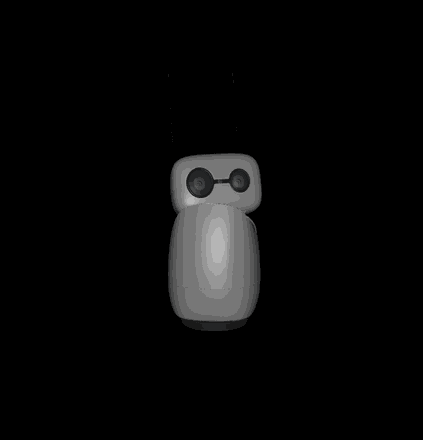

# BBIA — Reachy Mini simulation

Python cognitive / simulation engine for [Reachy Mini](https://github.com/pollen-robotics/reachy_mini) (emotions, vision, MuJoCo).

**Sim-first**: without `BBIA_ALLOW_HARDWARE=1`, no physical `ReachyMini()` client — MuJoCo / simulation only.

[](https://github.com/arkalia-luna-system/bbia-sim)
[](https://python.org)
[](https://github.com/pollen-robotics/reachy_mini)
[](LICENSE)
[](https://github.com/arkalia-luna-system/bbia-sim/actions/workflows/ci.yml?query=branch%3Amain)
[](https://github.com/arkalia-luna-system/bbia-sim/actions/workflows/ci.yml?query=branch%3Adevelop)
[](https://app.codecov.io/gh/arkalia-luna-system/bbia-sim)

## Honest status (showcase)

| Area | Tip reality (2 Nov 2026) |
|:-----|:-------------------------|
| **Default mode** | **Sim-first** — hardware only with `BBIA_ALLOW_HARDWARE=1` |
| **Pollen SDK** | **reachy-mini 1.13.0** via `pip install -e ".[reachy]"` (Python ≥3.11 for that extra) |
| **App-layer scores** | Subjective **10/10** software domains — see [`docs/reference/project-status.md`](docs/reference/project-status.md) |
| **Pollen hardware / firmware** | Cap **≤7/10** — yaw/sleep/Wireless/GStreamer host remain upstream |
| **“100% real-robot validated”** | **Not claimed** — dry-run + [`PREMIER_JOUR_ROBOT.md`](docs/hardware/PREMIER_JOUR_ROBOT.md) |

French README (canonical): [`README.md`](README.md) · Security: [`SECURITY.md`](SECURITY.md) · Robot safety: [`docs/hardware/SECURITE_ROBOT.md`](docs/hardware/SECURITE_ROBOT.md)

---



### Key features

| Feature | Details |
|:---|:---|
| **Pollen SDK** | Tracked alignment **v1.13.0** (`.[reachy]`) — not a Pollen certification |
| **Unified backend** | Same API for sim / real; real requires `BBIA_ALLOW_HARDWARE=1` |
| **Tests** | Large pytest suite (historical local snapshot ~2.3k collected) — CI unit job excludes e2e/benchmarks |
| **Docs** | ~115 Markdown files under `docs/` |
| **CI/CD** | Black, Ruff, MyPy, Bandit, gitleaks — **main** / **develop** badges above |
| **License** | MIT |

## Statistics (orders of magnitude)

- **Python sources** (`src/bbia_sim`): ~145 `.py` modules (tip 2 Nov 2026)
- **Test files**: ~225 `test_*.py`
- **Collected tests**: historical local snapshot (8 May 2026) ~2,311 — re-run `pytest --collect-only` for tip
- **Coverage**: [Codecov CI](https://app.codecov.io/gh/arkalia-luna-system/bbia-sim)
- **Examples**: ~85 Python scripts under `examples/`

## Code quality

- Coverage tracked in CI (progressive unit threshold — not “80% whole repo”)
- Linting: black, ruff, mypy, bandit
- Python: core `>=3.10`; Reachy extra `>=3.11`; CI 3.11 + 3.12
- App-layer scores **10/10** ≠ Pollen hardware (≤7)

**[Quick Start](#-quick-start)** · **[Getting started](docs/guides/GUIDE_DEMARRAGE.md)** · **[Advanced](docs/guides/GUIDE_AVANCE.md)** · **[Status](docs/reference/project-status.md)**

---

**v1.4.0** — MuJoCo simulation + BBIA modules + Pollen SDK **1.13.0**. **Sim-first**; not a “production-ready robot” promise.

---

## 🚀 Quick Start

### Prerequisites

- Python 3.10+ (Reachy SDK extra: 3.11+)
- pip
- (Optional) Docker & Docker Compose for containerized environment

### Installation

#### Option 1: Standard Installation

```bash
# Clone repository
git clone https://github.com/arkalia-luna-system/bbia-sim.git
cd bbia-sim

# Install dependencies
pip install -e ".[test]"

# Run tests
pytest tests/ -v
```

#### Option 2: Docker Compose (Recommended)

```bash
# Clone repository
git clone https://github.com/arkalia-luna-system/bbia-sim.git
cd bbia-sim

# Start with Docker Compose
docker-compose up -d

# Check API health
curl http://localhost:8000/api/health
```

### Run Simulation

```bash
# Start API server
BBIA_TOKEN=your-secret-key uvicorn src.bbia_sim.daemon.app.main:app --port 8000

# Access dashboard
open http://localhost:8000
```

---

## 🎯 Features

### 12 Robotic Emotions

- **6 Official SDK emotions**: neutral, happy, sad, angry, curious, excited
- **6 Extended emotions**: surprised, fearful, confused, determined, nostalgic, proud

### 21 Intelligent Behaviors

- **Base behaviors** (7): Wake Up, Greeting, Emotional Response, Vision Tracking, Conversation, Antenna Animation, Hide
- **Advanced behaviors** (14): Follow Face, Follow Object, Dance, Emotion Show, Photo Booth, Storytelling, Teaching, Game, Meditation, Exercise, Alarm Clock, Weather Report, News Reader, Music Reaction

### Advanced AI Integration

- **Computer Vision**: YOLOv8n (object detection), MediaPipe (face/pose detection), DeepFace (emotion recognition)
- **Speech**: Whisper (STT), pyttsx3 (TTS), VAD (Voice Activity Detection)
- **NLP**: Transformers, Phi-2/TinyLlama (LLM), sentence-transformers
- **Function Calling**: Automatic detection of 6 robot actions

### Unified backend

- Same application code path for simulation and real hardware
- Real robot requires explicit `BBIA_ALLOW_HARDWARE=1`
- Tracked API alignment with Pollen SDK **1.13.0** (not a Pollen certification)

---

## Documentation

- [Getting started](docs/guides/GUIDE_DEMARRAGE.md)
- [Advanced](docs/guides/GUIDE_AVANCE.md)
- [Project status](docs/reference/project-status.md)
- [First-day robot](docs/hardware/PREMIER_JOUR_ROBOT.md) / [Robot safety](docs/hardware/SECURITE_ROBOT.md)
- [Contribution guide](docs/community/CONTRIBUTION_GUIDE.md)

---

## Testing

```bash
pytest tests/ --cov=src/bbia_sim --cov-report=term-missing
pytest tests/test_reachy_mini_full_conformity_official.py -v
```

- Historical local collect snapshot (8 May 2026): ~2,311 — re-check tip with `pytest --collect-only`
- SDK conformity suite documented under `docs/quality/compliance/` (API alignment tests, not “real robot 100%”)
- Coverage reference: [Codecov](https://app.codecov.io/gh/arkalia-luna-system/bbia-sim)

---

## Contributing

See [CONTRIBUTING.md](CONTRIBUTING.md) and [Contribution Guide](docs/community/CONTRIBUTION_GUIDE.md).

---

## License

MIT — see [LICENSE](LICENSE).

---

## Acknowledgments

- Pollen Robotics — Reachy Mini SDK
- MuJoCo — physics simulation
- Hugging Face — models / transformers
- OpenAI Whisper — speech recognition (optional stack)

---

## Contact

- GitHub: [arkalia-luna-system/bbia-sim](https://github.com/arkalia-luna-system/bbia-sim)
- Security: [SECURITY.md](SECURITY.md)

---

*Showcase last updated: 2 November 2026*

