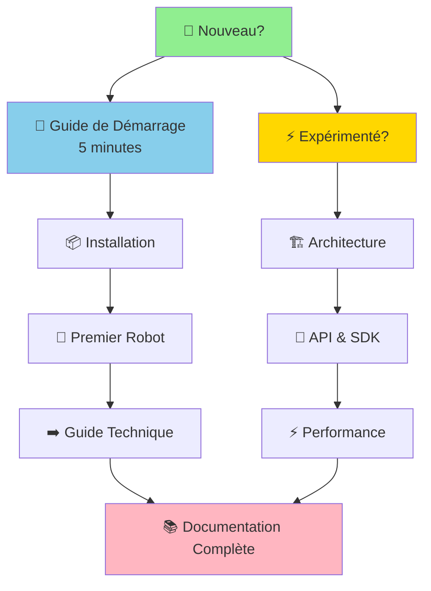

# 📚 Documentation BBIA-SIM — Navigation Rapide

**Dernière mise à jour :** 2 Novembre 2026  
**Version** : v1.4.0  
**Mode** : **sim-first** — robot physique uniquement avec `BBIA_ALLOW_HARDWARE=1` ([PREMIER_JOUR](hardware/PREMIER_JOUR_ROBOT.md), [SÉCURITÉ](hardware/SECURITE_ROBOT.md)).  
**Statut Robot (déclaratif lab)** : reçu 18 déc 2025, monté 20 déc 2025 ; moteurs 1/2/4 (QC 2549 / 2548). Campagne e2e hardware publique **non** revendiquée comme « 100 % validée ».  
**Scores** : app-layer logiciels **10/10** (subjectifs tip) · hardware Pollen **≤7** — [`reference/project-status.md`](reference/project-status.md).  
**SDK Reachy Mini** : **v1.13.0** (PyPI) — extra `.[reachy]`, Python ≥3.11 pour le SDK.

> **Moteur cognitif Python pour Reachy Mini**  
> *Simulation-first • IA optionnelle • Alignement SDK 1.13 (pas certification Pollen)*

---

## 🚀 Nouveau sur le projet ? Commencez ici

> **⭐ POINT DE DÉPART RECOMMANDÉ** : Commencez par le **[Guide de Démarrage](guides/GUIDE_DEMARRAGE.md)** — Installation et premiers pas en 5 minutes

---

## 🎯 Parcours Recommandé

---

## 📊 Statut et Suivi

> **📈 Vue d'ensemble du projet**

| Document | Description | Public |
|----------|-------------|--------|
| **[project-status.md](reference/project-status.md)** | Tableau de bord complet par axe | Tous |

---

## 🏗️ Architecture & Design

> **Structure technique du projet**

### Documents Principaux

| Document | Description | Niveau |
|----------|-------------|--------|
| [ARCHITECTURE_OVERVIEW.md](development/architecture/ARCHITECTURE_OVERVIEW.md) | Vue d'ensemble (v1.4.0) | 🟢 Accessible |
| [ARCHITECTURE.md](development/architecture/ARCHITECTURE.md) | Guide architecture | 🟡 Intermédiaire |
| [ARCHITECTURE_DETAILED.md](development/architecture/ARCHITECTURE_DETAILED.md) | Détails techniques | 🔴 Avancé |

---

## 📖 Guides Utilisateurs

> **Apprendre à utiliser BBIA-SIM**

### Par Niveau

- 🟢 **[Guide de Démarrage](guides/GUIDE_DEMARRAGE.md)** — Installation et premiers pas en 5 minutes
- 🟡 **[Guide Technique](guides/GUIDE_AVANCE.md)** — Fonctionnalités techniques et architecture
- 🔴 **[Guides Techniques](development/)** — Intégration, tests, migration

### Par Sujet

- 🤖 **[Reachy Mini Wireless](guides/REACHY_MINI_WIRELESS_COMPLETE_GUIDE.md)** — Guide complet du robot physique
- 💬 **[Chat BBIA](guides/GUIDE_CHAT_BBIA.md)** — Système de chat
- 🧠 **[NLP & SmolVLM2](guides/GUIDE_NLP_SMOLVLM.md)** — Intelligence artificielle

---

## 📦 Références & Historique

> **Version et historique du projet**

- 📝 **[RELEASE_NOTES.md](reference/RELEASE_NOTES.md)** — Notes de version
- 📚 **[PROJECT_HISTORY.md](reference/PROJECT_HISTORY.md)** — Historique du projet
- 🔄 **[CHANGELOG.md](../CHANGELOG.md)** — Journal des modifications

---

## ✅ Conformité & Qualité

> **Vérification et validation**

### Conformité SDK

- ✅ **[Conformité Complète](quality/compliance/CONFORMITE_REACHY_MINI_COMPLETE.md)** — Validation SDK officiel
- 🔍 **[Audit Synthèse](quality/INDEX_AUDITS.md)** — Audits consolidés

### Qualité Code

- 🎯 **[Watchdog / perf](quality/performance/WATCHDOG_IMPLEMENTATION.md)** — Perf active
- ✅ **[Index Audits](quality/INDEX_AUDITS.md)** — Actifs + historiques archivés
- 📦 **[Archives doc](_archived/README.md)** — Snapshots hors valeur tip

---

## 📁 Navigation Complète

- **[Guide de Navigation](getting-started/NAVIGATION.md)** — Guide pour trouver rapidement ce dont vous avez besoin
- **[INDEX_FINAL.md](INDEX_FINAL.md)** — Index complet avec navigation par profil et catégorie

---

**💡 Aide** : [Guide de Démarrage](guides/GUIDE_DEMARRAGE.md) • [Troubleshooting](getting-started/troubleshooting.md)

**Dernière mise à jour** : 2 Novembre 2026
